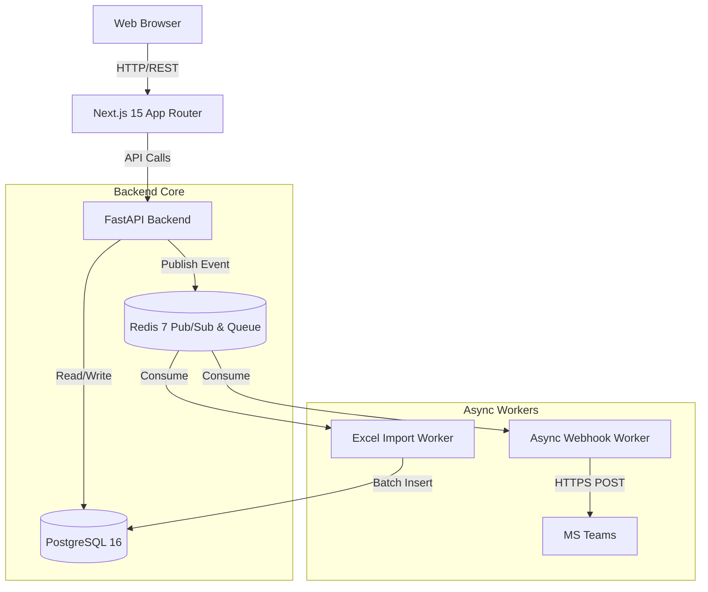
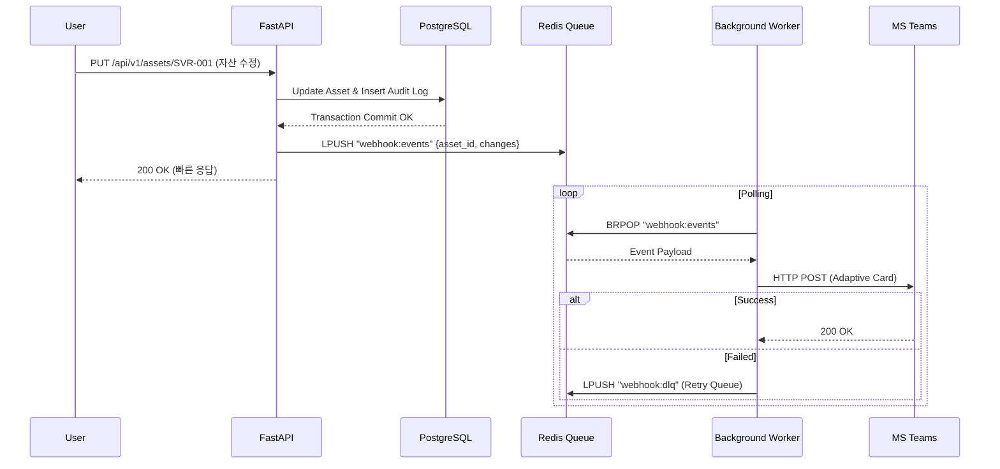

# xenon_itam
# Xenon ITAM (자산 관리 솔루션)

기존 엑셀(Excel) 기반의 파편화된 인프라/정보보호 자산 데이터를 통합하고, 통제력과 가시성을 제공하기 위해 자체 개발된 웹 표준 자산 관리 플랫폼(In-house ITAM System)입니다.

초기 대용량 엑셀 마이그레이션을 안정적으로 수용하고, 향후 자동 수집 에이전트, AD/LDAP 조직도 동기화, EntraID SSO 연동까지 가능하도록 설계된 확장형 아키텍처를 가집니다.

---

## 1. 시스템 아키텍처 (System Architecture)

전체 시스템은 Next.js 기반의 프론트엔드와 FastAPI 기반의 백엔드가 분리된 MSA 지향 구조를 가집니다. 무거운 작업(대량 엑셀 파싱, 웹훅 발송 등)은 Redis 기반의 비동기 워커 큐로 오프로딩합니다.

### 1.1 컴포넌트 아키텍처



### 1.2 비동기 웹훅 처리 시퀀스 (Event Bus)

자산 변경 시 클라이언트 응답을 지연시키지 않도록, 이벤트 버스(Redis)를 거쳐 비동기로 알림을 처리합니다.



---

## 2. 데이터베이스 스키마 설계 (Database DDL)

각 기술 자산(서버, DB, WAS 등)의 이질적인 가변 속성을 수용하기 위해 PostgreSQL의 `JSONB` 타입과 `GIN` 인덱스를 활용하는 하이브리드 모델링을 적용했습니다.

### 2.1 코어 자산 테이블 및 JSONB (DDL)

```sql
-- 1. 마스터 자산 테이블 (공통 속성)
CREATE TABLE assets (
    id UUID PRIMARY KEY DEFAULT gen_random_uuid(),
    asset_code VARCHAR(50) UNIQUE NOT NULL, -- 예: SVR-2610-001
    asset_type VARCHAR(30) NOT NULL,        -- SERVER, STORAGE, CLOUD, DB 등
    name VARCHAR(255) NOT NULL,             -- 호스트명 또는 서비스명
    status VARCHAR(20) DEFAULT 'ACTIVE',    -- 운영, 폐기, 테스트 등
    owner_id UUID REFERENCES users(id),     -- 담당자 FK
    department VARCHAR(100),
    created_at TIMESTAMPTZ DEFAULT NOW(),
    updated_at TIMESTAMPTZ DEFAULT NOW()
);
CREATE INDEX idx_assets_type_status ON assets(asset_type, status);

-- 2. 자산 가변 속성 테이블 (JSONB 활용)
CREATE TABLE asset_properties (
    asset_id UUID PRIMARY KEY REFERENCES assets(id) ON DELETE CASCADE,
    properties JSONB NOT NULL DEFAULT '{}'::jsonb
);
-- JSONB 내부 Key-Value 검색을 위한 GIN 인덱스 적용
CREATE INDEX idx_asset_properties_gin ON asset_properties USING GIN (properties);

-- 3. 자산 변경 이력 (Audit Logs)
CREATE TABLE audit_logs (
    id UUID PRIMARY KEY DEFAULT gen_random_uuid(),
    asset_id UUID REFERENCES assets(id),
    user_id UUID REFERENCES users(id),
    action VARCHAR(20) NOT NULL,            -- CREATE, UPDATE, DELETE, IMPORT
    old_data JSONB,
    new_data JSONB,
    created_at TIMESTAMPTZ DEFAULT NOW()
);
```

### 2.2 위젯/행 단위 권한 제어 (RBAC)

```sql
CREATE TABLE roles (
    id SERIAL PRIMARY KEY,
    name VARCHAR(50) UNIQUE NOT NULL,       -- ADMIN, INFRA_MGR, SEC_AUDITOR
    description VARCHAR(255)
);

CREATE TABLE permissions (
    id SERIAL PRIMARY KEY,
    resource VARCHAR(50) NOT NULL,          -- ASSET_SERVER, DASHBOARD_COST, IDC_LOG
    action VARCHAR(20) NOT NULL,            -- READ, WRITE, EXPORT, MASKED_READ
    UNIQUE(resource, action)
);

CREATE TABLE role_permissions (
    role_id INT REFERENCES roles(id),
    permission_id INT REFERENCES permissions(id),
    PRIMARY KEY (role_id, permission_id)
);

CREATE TABLE user_roles (
    user_id UUID REFERENCES users(id),
    role_id INT REFERENCES roles(id),
    PRIMARY KEY (user_id, role_id)
);
```

---

## 3. 핵심 API 명세 (API Specifications)

### 3.1 동적 JSONB 필터링 자산 조회

`GET /api/v1/assets?type=SERVER&properties={"os_type":"RHEL","db_eos_status":"WARNING"}`

```json
{
  "total": 1250,
  "page": 1,
  "data": [
    {
      "id": "a1b2c3d4-...",
      "asset_code": "SVR-2026-089",
      "asset_type": "SERVER",
      "name": "WAS-PRD-01",
      "status": "운영",
      "owner": { "name": "맹호빈", "department": "아키텍처 인프라팀" },
      "properties": {
        "manufacturer": "HPE",
        "os_type": "RHEL 8.4",
        "cpu_cores": 32,
        "memory_gb": 128,
        "ip_address": "10.10.5.21"
      },
      "updated_at": "2026-10-13T10:30:00Z"
    }
  ]
}
```

### 3.2 비동기 엑셀 임포트 (마이그레이션)

`POST /api/v1/assets/import`
- **Request:** `multipart/form-data` (file: `자산관리엑셀.xlsx`)
- **Response:**
```json
{
  "task_id": "task-uuid-8899",
  "status": "PROCESSING",
  "message": "엑셀 파일이 큐에 등록되었습니다. 진행 상황은 /api/v1/tasks/{task_id} 에서 확인하세요."
}
```

---

## 4. 백엔드 코어 비즈니스 로직 (FastAPI)

### 4.1 RBAC 검증 (Dependency Injection)

```python
# app/core/security.py
from fastapi import Depends, HTTPException, status

def require_permission(resource: str, action: str):
    async def permission_checker(current_user: User = Depends(get_current_user)):
        has_perm = await check_user_permission(current_user.id, resource, action)
        if not has_perm:
            raise HTTPException(
                status_code=status.HTTP_403_FORBIDDEN,
                detail=f"권한이 부족합니다. ({resource}:{action} 필요)"
            )
        return current_user
    return permission_checker
```

### 4.2 Redis 기반 웹훅 비동기 워커

```python
# app/workers/webhook_worker.py
import asyncio, json, httpx
from redis.asyncio import Redis

async def process_webhook_queue(redis_client: Redis):
    while True:
        try:
            result = await redis_client.brpop("webhook:queue", timeout=5)
            if result:
                _, payload_str = result
                event = json.loads(payload_str)
                teams_payload = format_teams_card(event)
                
                async with httpx.AsyncClient() as client:
                    response = await client.post(TEAMS_WEBHOOK_URL, json=teams_payload, timeout=10.0)
                    response.raise_for_status()
        except httpx.HTTPError as e:
            await redis_client.lpush("webhook:dlq", payload_str) # DLQ 처리
        except Exception as e:
            await asyncio.sleep(1)
```

---

## 5. 프론트엔드 아키텍처 (Next.js 15)

수천 건의 자산을 렌더링하기 위해 DOM 노드를 최소화하는 **Virtual Scroll (react-window)** 기술과 **TanStack Table v8**을 조합하여 구성합니다.

### 5.1 폴더 구조 (App Router)

```text
/src
 ├── app/
 │   ├── (auth)/login/page.tsx
 │   ├── (dashboard)/
 │   │   ├── layout.tsx             # 전역 GNB/LNB 및 Auth Provider
 │   │   ├── page.tsx               # 커스텀 위젯 대시보드 (react-grid-layout)
 │   │   └── assets/[type]/page.tsx # 자산 타입별 동적 데이터 그리드
 ├── components/
 │   ├── ui/                        # shadcn/ui 기반 공통 컴포넌트
 │   ├── data-table/                # TanStack Table + react-window 통합 뷰
 │   └── widgets/                   # 대시보드 통계용 Recharts 위젯
 ├── lib/
 │   ├── api.ts                     # Axios 인스턴
 │   └── store.ts                   # Zustand (RBAC 상태 관리)
 └── types/
     └── asset.d.ts                 # JSONB 속성 TypeScript 인터페이스
```

---

## 6. 인프라 배포 (Docker Integration)

개발 및 온프레미스 배포를 위한 Multi-Container 환경 설정입니다.

`docker-compose.yml`
```yaml
version: '3.8'

services:
  db:
    image: postgres:16-alpine
    container_name: xenon-postgres
    environment:
      POSTGRES_USER: xenon_admin
      POSTGRES_PASSWORD: xenon_password
      POSTGRES_DB: xenon_db
      TZ: Asia/Seoul
    ports:
      - "5432:5432"
    volumes:
      - pgdata:/var/lib/postgresql/data

  redis:
    image: redis:7-alpine
    container_name: xenon-redis
    ports:
      - "6379:6379"
    volumes:
      - redisdata:/data

  api:
    build: 
      context: ./backend
    container_name: xenon-api
    command: uvicorn app.main:app --host 0.0.0.0 --port 8000 --reload
    environment:
      - DATABASE_URL=postgresql+asyncpg://xenon_admin:xenon_password@db:5432/xenon_db
      - REDIS_URL=redis://redis:6379/0
    ports:
      - "8000:8000"
    depends_on:
      - db
      - redis

  web:
    build:
      context: ./frontend
    container_name: xenon-web
    environment:
      - NEXT_PUBLIC_API_URL=http://localhost:8000/api/v1
    ports:
      - "3000:3000"
    depends_on:
      - api

volumes:
  pgdata:
  redisdata:
```
