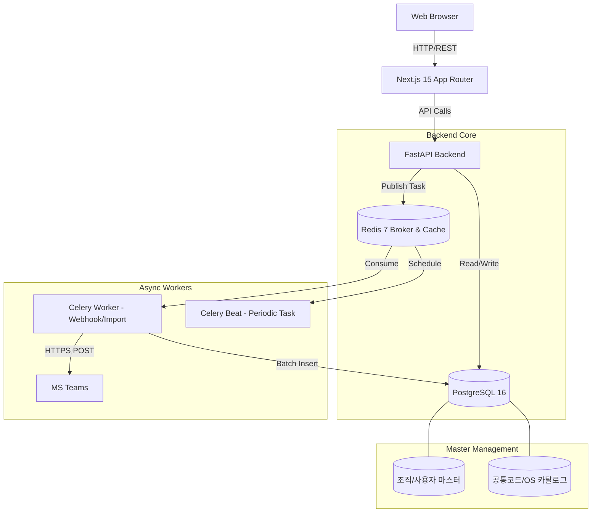
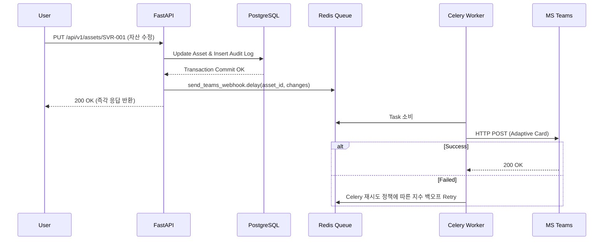

# Xenon ITAM (엔터프라이즈 IT 자산 관리 솔루션)

기존 엑셀(Excel) 기반의 파편화된 인프라/정보보호 자산 데이터를 웹 표준 플랫폼으로 통합하고, 완벽한 통제력과 가시성을 제공하기 위해 개발된 자체 ITAM(IT Asset Management) 플랫폼입니다.

초기 대용량 엑셀 마이그레이션을 안정적으로 수용하며, **표준 공통 코드 및 조직 마스터(회사/부서/사용자) 기반의 입력 통제**, **관리자가 웹 UI에서 자산별 커스텀 어트리뷰트(속성)를 자유롭게 추가/확장**할 수 있는 동적 스키마 아키텍처를 제공합니다. 향후 자동 수집 에이전트, AD/LDAP 조직도 동기화, EntraID SSO 연동을 고려한 확장 구조를 가집니다.

---

## 1. 확정 기술 스택 명세 (Technology Stack)

| 레이어 (Layer) | 분류 (Category) | 기술 스택 / 라이브러리 | 버전 (Version) | 도입 목적 및 상세 역할 |
| :--- | :--- | :--- | :--- | :--- |
| **Frontend** | Framework | Next.js (App Router) | 15.x | SSR/SSG 하이브리드 지원, 직관적인 라우팅 및 엔터프라이즈 웹 앱 기반 구조 제공 |
| | Language | TypeScript | 5.x | 컴파일 타임 엄격한 타입 검증으로 대규모 자산 데이터 모델의 런타임 에러 방지 |
| | UI Library | shadcn/ui & Tailwind CSS | Latest / 3.4+ | 일관된 디자인 시스템 및 고도로 커스터마이징 가능한 컴포넌트 스타일링 |
| | Data Grid | TanStack Table (v8) | 8.x | 헤드리스 기반의 복합 정렬, 다중 필터링, 컬럼 숨김/리사이징 상태 제어 |
| | Virtualization | react-window | 1.8+ | DOM 노드 가상화(Virtual Scroll)로 수만 행의 자산 데이터 스크롤 시 브라우저 메모리 부하 방지 |
| | State Mgt | Zustand | 4.x | 경량 전역 상태 관리 (사용자 세션, RBAC 권한, 커스텀 대시보드 위젯 배치 상태 저장) |
| | Dashboard Chart | Recharts | 2.x | 부서별 자산 현황, OS별 EoS 도래 일정, 인프라 비용 통계 시각화 |
| | HTTP Client | Axios | 1.x | API 통신 인터셉터(JWT 토큰 갱신, 에러 핸들링) 구현 |
| **Backend** | Framework | FastAPI | 0.110+ | 고성능 Python 비동기(AsyncIO) 프레임워크, 자동 OpenAPI(Swagger) 문서화 |
| | Language | Python | 3.11+ | 네이티브 비동기 처리 최적화 및 안정적인 패키지 생태계 |
| | Validation | Pydantic v2 | 2.x | 러스트 기반 코어로 고속 데이터 파싱 및 가변 JSON 속성 스키마 유효성 검증 |
| | Database ORM | SQLAlchemy 2.0 (Async) | 2.x | 완전한 비동기 DB 세션 지원, 하이브리드 EAV-JSONB 매핑 제어 |
| | Migration | Alembic | 1.13+ | 선언적 DB 스키마 형상 관리 및 버전 관리 자동화 |
| | Async Worker | Celery | 5.3+ | Teams 웹훅 알림 비동기 큐잉 및 대용량 배치/스케줄러 작업 처리 |
| | Data Pipeline | Pandas / OpenPyXL | 2.x / 3.x | 기존 13개 시트 엑셀 파일의 스트리밍/청크 단위 고속 파싱 및 데이터 정제 |
| **Database** | RDBMS & JSONB | PostgreSQL | 16-alpine | 공통 속성 RDB 관계 제어 + 가변 속성 JSONB 수용 및 GIN 인덱스를 통한 고속 검색 |
| **Cache & Queue** | Cache / Event Bus | Redis | 7-alpine | 대시보드 집계 캐싱, 세션 저장소, Celery 메시지 브로커 |
| **Infrastructure** | Containerization | Docker & Docker Compose | Latest | 개발 및 온프레미스 배포 환경의 멀티 컨테이너 통합 오케스트레이션 |

---

## 2. 시스템 아키텍처 및 이벤트 흐름 (System Architecture)

전체 시스템은 Next.js 기반의 프론트엔드와 FastAPI 기반의 백엔드가 분리된 구조입니다. 대량 엑셀 파싱 및 Teams 웹훅 발송 등 부하가 큰 작업은 Redis 기반의 Celery 워커 큐로 오프로딩합니다.

### 2.1 컴포넌트 아키텍처



### 2.2 비동기 웹훅 처리 시퀀스 (Event Bus)



---

## 3. 데이터베이스 스키마 상세 설계 (PostgreSQL 16 DDL)

데이터 오염 방지를 위한 **표준 조직/코드 마스터 테이블**, **자산 공통 테이블(`assets`)**, **동적 커스텀 속성 정의(`asset_attribute_definitions`)**, 그리고 **JSONB + GIN 인덱스(`asset_properties`)**의 결합 구조입니다.

### 3.1 조직 및 공통 코드 마스터 스키마 (데이터 정합성 보장)

```sql
-- 1. 회사/법인 마스터
CREATE TABLE companies (
    id SERIAL PRIMARY KEY,
    code VARCHAR(50) UNIQUE NOT NULL,       -- 예: DONG_A_ST, DA_INFO
    name VARCHAR(100) NOT NULL,              -- 예: 동아에스티, 디에이인포메이션
    is_active BOOLEAN DEFAULT TRUE
);

-- 2. 부서 계층 마스터 (향후 AD/LDAP 트리 구조 동기화 대비)
CREATE TABLE departments (
    id SERIAL PRIMARY KEY,
    company_id INT REFERENCES companies(id) ON DELETE RESTRICT,
    parent_id INT REFERENCES departments(id), -- 상위 부서 ID (재귀 구조)
    code VARCHAR(50) NOT NULL,
    name VARCHAR(100) NOT NULL,              -- 예: 아키텍처 인프라팀
    is_active BOOLEAN DEFAULT TRUE,
    UNIQUE(company_id, code)
);

-- 3. 시스템 사용자 및 담당자 마스터
CREATE TABLE users (
    id UUID PRIMARY KEY DEFAULT gen_random_uuid(),
    username VARCHAR(50) UNIQUE NOT NULL,   -- 사번 또는 AD 로그인 계정
    email VARCHAR(100) UNIQUE NOT NULL,
    full_name VARCHAR(50) NOT NULL,         -- 이름
    company_id INT REFERENCES companies(id),
    department_id INT REFERENCES departments(id),
    title VARCHAR(50),                      -- 직급/직책 (예: 책임)
    is_active BOOLEAN DEFAULT TRUE,
    created_at TIMESTAMPTZ DEFAULT NOW()
);

-- 4. 공통 코드 마스터 (상태, IDC 위치, 자산 분류 등 관리)
CREATE TABLE common_codes (
    id SERIAL PRIMARY KEY,
    category VARCHAR(50) NOT NULL,          -- ASSET_STATUS, VENDOR, LOCATION 등
    code VARCHAR(50) NOT NULL,              -- PROD, DEV, IDC_GCH, DELL 등
    name VARCHAR(100) NOT NULL,             -- 운영, 개발, 고척 IDC, Dell Technologies
    sort_order INT DEFAULT 0,
    is_active BOOLEAN DEFAULT TRUE,
    UNIQUE(category, code)
);

-- 5. 표준 소프트웨어/OS 카탈로그 (EoS 통계 연동용)
CREATE TABLE software_catalog (
    id SERIAL PRIMARY KEY,
    category VARCHAR(30) NOT NULL,          -- OS, DBMS, WAS, WEB
    vendor VARCHAR(50) NOT NULL,            -- RedHat, Microsoft, Oracle 등
    name VARCHAR(100) NOT NULL,             -- RHEL, Windows Server, Oracle DB
    version VARCHAR(50) NOT NULL,          -- 8.4, 2022, 19c
    eos_date DATE,                          -- EoS 도래일 (통계 및 경고 배지 자동 연동)
    is_active BOOLEAN DEFAULT TRUE,
    UNIQUE(category, name, version)
);
```

### 3.2 코어 자산, 가변 속성(JSONB) 및 동적 어트리뷰트 스키마

```sql
-- 6. 마스터 자산 테이블 (모든 자산 공통 식별 정보 + 마스터 데이터 FK 연계)
CREATE TABLE assets (
    id UUID PRIMARY KEY DEFAULT gen_random_uuid(),
    asset_code VARCHAR(50) UNIQUE NOT NULL,      -- 자산관리코드 (예: SVR-2610-001)
    asset_type VARCHAR(30) NOT NULL,             -- SERVER, STORAGE, CLOUD, DB 등
    name VARCHAR(255) NOT NULL,                  -- 호스트명 또는 서비스명
    status_code VARCHAR(50) NOT NULL,            -- common_codes 참조 (PROD, DEV 등)
    service_company_id INT REFERENCES companies(id),    -- 서비스 대상 회사
    owner_user_id UUID REFERENCES users(id),            -- 자산 소유자/정담당자
    sub_owner_user_id UUID REFERENCES users(id),        -- 부담당자
    managed_dept_id INT REFERENCES departments(id),     -- 관리 부서
    standard_os_id INT REFERENCES software_catalog(id), -- 표준 OS (해당 시 선택)
    primary_ip VARCHAR(45),                             -- 대표 IP 주소
    created_at TIMESTAMPTZ DEFAULT NOW(),
    updated_at TIMESTAMPTZ DEFAULT NOW()
);
CREATE INDEX idx_assets_type_status ON assets(asset_type, status_code);
CREATE INDEX idx_assets_owner ON assets(owner_user_id);

-- 7. 동적 커스텀 어트리뷰트 메타데이터 (사용자가 웹에서 추가한 필드)
CREATE TABLE asset_attribute_definitions (
    id UUID PRIMARY KEY DEFAULT gen_random_uuid(),
    asset_type VARCHAR(30) NOT NULL,        -- 해당 속성이 적용될 자산 분류 (SERVER 등)
    field_key VARCHAR(50) NOT NULL,         -- JSON 내부 Key (예: backup_policy, gpu_model)
    field_label VARCHAR(100) NOT NULL,       -- UI 표시명 (예: 백업 정책, GPU 모델)
    data_type VARCHAR(20) NOT NULL,         -- string, number, boolean, date, select, common_code
    ref_category VARCHAR(50),               -- data_type이 common_code일 때 참조할 카테고리
    options JSONB DEFAULT '[]'::jsonb,      -- custom select 타입일 경우 옵션 배열
    is_required BOOLEAN DEFAULT FALSE,      -- 필수 입력 여부
    is_searchable BOOLEAN DEFAULT TRUE,     -- 대시보드/그리드 필터 대상 여부
    created_at TIMESTAMPTZ DEFAULT NOW(),
    UNIQUE(asset_type, field_key)
);

-- 8. 자산 가변 속성 테이블 (JSONB 및 GIN 인덱스)
CREATE TABLE asset_properties (
    asset_id UUID PRIMARY KEY REFERENCES assets(id) ON DELETE CASCADE,
    properties JSONB NOT NULL DEFAULT '{}'::jsonb
);
CREATE INDEX idx_asset_properties_gin ON asset_properties USING GIN (properties);

-- 9. 자산 변경 이력 (Audit Logs)
CREATE TABLE audit_logs (
    id UUID PRIMARY KEY DEFAULT gen_random_uuid(),
    asset_id UUID REFERENCES assets(id),
    user_id UUID REFERENCES users(id),
    action VARCHAR(20) NOT NULL,            -- CREATE, UPDATE, DELETE, IMPORT
    old_data JSONB,
    new_data JSONB,
    created_at TIMESTAMPTZ DEFAULT NOW()
);
```

### 3.3 세밀한 위젯/행/열 단위 권한 제어 (RBAC)

```sql
CREATE TABLE roles (
    id SERIAL PRIMARY KEY,
    name VARCHAR(50) UNIQUE NOT NULL,       -- ADMIN, INFRA_MGR, SEC_AUDITOR
    description VARCHAR(255)
);

CREATE TABLE permissions (
    id SERIAL PRIMARY KEY,
    resource VARCHAR(50) NOT NULL,          -- ASSET_SERVER, DASHBOARD_COST, IDC_LOG, CODE_MANAGE
    action VARCHAR(20) NOT NULL,            -- READ, WRITE, EXPORT, MASKED_READ
    UNIQUE(resource, action)
);

CREATE TABLE role_permissions (
    role_id INT REFERENCES roles(id),
    permission_id INT REFERENCES permissions(id),
    PRIMARY KEY (role_id, permission_id)
);

CREATE TABLE user_roles (
    user_id UUID REFERENCES users(id),
    role_id INT REFERENCES roles(id),
    PRIMARY KEY (user_id, role_id)
);
```

---

## 4. 핵심 API 명세 (API Specifications)

### 4.1 마스터 데이터 조회 API (SelectBox 드롭다운 바인딩용)
*   `GET /api/v1/masters/companies`: 법인/회사 목록 조회
*   `GET /api/v1/masters/departments?company_id={id}`: 특정 회사의 부서 트리 목록
*   `GET /api/v1/masters/users?department_id={id}`: 부서별 담당자(사용자) 목록
*   `GET /api/v1/masters/codes?category={cat}`: 공통 코드 목록 (상태, 제조사 등)
*   `GET /api/v1/masters/software-catalog?category=OS`: 표준 OS 카탈로그 (EoS 일자 포함)

### 4.2 동적 어트리뷰트 관리 API
*   **Endpoint:** `POST /api/v1/attributes/definitions`
*   **Request Body:**
```json
{
  "asset_type": "SERVER",
  "field_key": "gpu_spec",
  "field_label": "GPU 규격",
  "data_type": "select",
  "options": ["NVIDIA A100", "NVIDIA H100", "None"],
  "is_required": false,
  "is_searchable": true
}
```

### 4.3 통합 자산 조회 및 동적 필터링 API
*   **Endpoint:** `GET /api/v1/assets?type=SERVER&company_id=1&os_catalog_id=12&properties={"gpu_spec":"NVIDIA H100"}`
*   **Response Payload:**
```json
{
  "total": 128,
  "page": 1,
  "data": [
    {
      "id": "a1b2c3d4-...",
      "asset_code": "SVR-2026-089",
      "asset_type": "SERVER",
      "name": "AI-TRAIN-01",
      "status": { "code": "PROD", "name": "운영" },
      "service_company": { "id": 1, "name": "동아에스티" },
      "managed_department": { "id": 10, "name": "아키텍처 인프라팀" },
      "owner": { "id": "u-1234", "name": "맹호빈", "title": "책임" },
      "standard_os": {
        "id": 12,
        "name": "RHEL",
        "version": "8.4",
        "eos_date": "2029-05-31",
        "eos_status": "NORMAL"
      },
      "primary_ip": "10.10.5.21",
      "properties": {
        "manufacturer": "HPE",
        "cpu_cores": 64,
        "memory_gb": 512,
        "gpu_spec": "NVIDIA H100"
      },
      "updated_at": "2026-10-13T10:30:00Z"
    }
  ]
}
```

### 4.4 대용량 엑셀 임포트 비동기 파이프라인
*   **Endpoint:** `POST /api/v1/assets/import`
*   **Request:** `multipart/form-data` (file: `자산관리엑셀.xlsx`, mode: `upsert`)
*   **Response:**
```json
{
  "task_id": "task-uuid-8899",
  "status": "PROCESSING",
  "message": "엑셀 파일이 큐에 등록되었습니다. 진행 상태는 /api/v1/tasks/{task_id} 에서 확인하세요."
}
```

---

## 5. 백엔드 코어 비즈니스 로직 (FastAPI & Celery)

### 5.1 마스터 데이터 검증 및 동적 속성 검증 엔진
```python
# app/services/asset_service.py
from fastapi import HTTPException
from app.models import Asset, AttributeDefinition, Company, User, SoftwareCatalog

async def validate_and_create_asset(db_session, payload: AssetCreateSchema):
    # 1. 마스터 데이터 무결성 검증 (정형 필드)
    company = await db_session.get(Company, payload.service_company_id)
    if not company or not company.is_active:
        raise HTTPException(status_code=400, detail="유효하지 않은 서비스 회사입니다.")
        
    owner = await db_session.get(User, payload.owner_user_id)
    if not owner or not owner.is_active:
        raise HTTPException(status_code=400, detail="유효하지 않은 담당자(사용자)입니다.")

    if payload.standard_os_id:
        os_info = await db_session.get(SoftwareCatalog, payload.standard_os_id)
        if not os_info:
            raise HTTPException(status_code=400, detail="유효하지 않은 표준 OS 카탈로그입니다.")

    # 2. 동적 어트리뷰트(JSONB) 검증
    definitions = await get_attribute_definitions(db_session, payload.asset_type)
    for defn in definitions:
        val = payload.properties.get(defn.field_key)
        if defn.is_required and val is None:
            raise HTTPException(status_code=400, detail=f"'{defn.field_label}' 속성은 필수 입력 항목입니다.")
        if val is not None and defn.data_type == "select" and val not in defn.options:
            raise HTTPException(status_code=400, detail=f"'{defn.field_label}'에 허용되지 않은 값: {val}")

    # 3. 자산 생성 처리 및 Celery 웹훅 트리거
```

### 5.2 RBAC 검증 (Dependency Injection)
```python
# app/core/security.py
from fastapi import Depends, HTTPException, status

def require_permission(resource: str, action: str):
    async def permission_checker(current_user: User = Depends(get_current_user)):
        has_perm = await check_user_permission(current_user.id, resource, action)
        if not has_perm:
            raise HTTPException(
                status_code=status.HTTP_403_FORBIDDEN,
                detail=f"권한이 부족합니다. ({resource}:{action} 필요)"
            )
        return current_user
    return permission_checker
```

### 5.3 Celery 비동기 웹훅 태스크
```python
# app/worker/tasks.py
import httpx
from app.core.celery_app import celery_app

@celery_app.task(bind=True, max_retries=3, default_retry_delay=5)
def send_teams_webhook(self, asset_id: str, action: str, changes: dict):
    try:
        card_payload = build_adaptive_card(asset_id, action, changes)
        response = httpx.post("[https://outlook.office.com/webhook/](https://outlook.office.com/webhook/)...", json=card_payload, timeout=10.0)
        response.raise_for_status()
    except Exception as exc:
        raise self.retry(exc=exc)
```

---

## 6. 프론트엔드 아키텍처 (Next.js 15)

### 6.1 폴더 구조 (App Router)

```text
/src
 ├── app/
 │   ├── (auth)/login/page.tsx
 │   ├── (dashboard)/
 │   │   ├── layout.tsx                # 전역 GNB/LNB 및 Auth Provider
 │   │   ├── page.tsx                  # 커스텀 위젯 대시보드 (react-grid-layout)
 │   │   ├── assets/[type]/page.tsx    # 자산 타입별 동적 데이터 그리드
 │   │   └── settings/
 │   │       ├── attributes/page.tsx   # 사용자 정의 어트리뷰트 관리
 │   │       ├── masters/page.tsx      # 공통 코드 및 OS 카탈로그 관리
 │   │       └── org/page.tsx          # 회사/부서/조직도 관리 UI
 ├── components/
 │   ├── ui/                           # shadcn/ui 기반 공통 컴포넌트
 │   ├── data-table/                   # TanStack Table + react-window 통합 가상 스크롤 그리드
 │   ├── dynamic-form/
 │   │   ├── DynamicFormRenderer.tsx   # JSONB 커스텀 필드 자동 렌더러
 │   │   └── OrgSelector.tsx           # 회사-부서-담당자 계층형 선택 컴포넌트
 │   └── widgets/                      # 대시보드 통계용 Recharts 위젯 (EoS 현황 등)
 ├── lib/
 │   ├── api.ts                        # Axios 인스턴스 (인터셉터 포함)
 │   └── store.ts                      # Zustand (RBAC 상태, 위젯 레이아웃 상태)
 └── types/
     └── asset.d.ts                    # 공통 및 동적 어트리뷰트 TypeScript 인터페이스
```

---

## 7. 컨테이너 배포 정의 (Docker Integration)

로컬 개발 환경에서 소스코드를 수정하면 컨테이너 재빌드 없이 즉시 반영(Hot-Reload & Fast Refresh)되도록 볼륨 마운트가 구성된 개발 완성형 `docker-compose.yml`입니다.

`docker-compose.yml`
```yaml
version: '3.8'

services:
  db:
    image: postgres:16-alpine
    container_name: xenon-itam-db
    environment:
      POSTGRES_USER: ${POSTGRES_USER:-xenon_admin}
      POSTGRES_PASSWORD: ${POSTGRES_PASSWORD:-xenon_password}
      POSTGRES_DB: ${POSTGRES_DB:-xenon_db}
      TZ: Asia/Seoul
    ports:
      - "5432:5432"
    volumes:
      - xenon_itam_pgdata:/var/lib/postgresql/data
    networks:
      - xenon_itam_network
    healthcheck:
      test: ["CMD-SHELL", "pg_isready -U ${POSTGRES_USER:-xenon_admin} -d ${POSTGRES_DB:-xenon_db}"]
      interval: 10s
      timeout: 5s
      retries: 5
      start_period: 10s

  redis:
    image: redis:7-alpine
    container_name: xenon-itam-redis
    ports:
      - "6379:6379"
    volumes:
      - xenon_itam_redisdata:/data
    networks:
      - xenon_itam_network
    healthcheck:
      test: ["CMD", "redis-cli", "ping"]
      interval: 10s
      timeout: 5s
      retries: 5

  backend:
    build:
      context: ./backend
      dockerfile: Dockerfile
    container_name: xenon-itam-backend
    command: uvicorn app.main:app --host 0.0.0.0 --port 8000 --reload
    env_file:
      - .env
    environment:
      DATABASE_URL: ${DATABASE_URL:-postgresql+asyncpg://xenon_admin:xenon_password@db:5432/xenon_db}
      REDIS_URL: ${REDIS_URL:-redis://redis:6379/0}
      TZ: Asia/Seoul
    ports:
      - "8000:8000"
    extra_hosts:
      - "host.docker.internal:host-gateway"
    volumes:
      - ./backend:/app
    networks:
      - xenon_itam_network
    depends_on:
      db:
        condition: service_healthy
      redis:
        condition: service_healthy

  celery-worker:
    build:
      context: ./backend
      dockerfile: Dockerfile
    container_name: xenon-itam-worker
    command: celery -A app.core.celery_app.celery_app worker --loglevel=info --concurrency=4
    env_file:
      - .env
    environment:
      DATABASE_URL: ${DATABASE_URL:-postgresql+asyncpg://xenon_admin:xenon_password@db:5432/xenon_db}
      REDIS_URL: ${REDIS_URL:-redis://redis:6379/0}
      TZ: Asia/Seoul
    extra_hosts:
      - "host.docker.internal:host-gateway"
    volumes:
      - ./backend:/app
    networks:
      - xenon_itam_network
    depends_on:
      db:
        condition: service_healthy
      redis:
        condition: service_healthy

  celery-beat:
    build:
      context: ./backend
      dockerfile: Dockerfile
    container_name: xenon-itam-beat
    command: celery -A app.core.celery_app.celery_app beat --loglevel=info
    env_file:
      - .env
    environment:
      DATABASE_URL: ${DATABASE_URL:-postgresql+asyncpg://xenon_admin:xenon_password@db:5432/xenon_db}
      REDIS_URL: ${REDIS_URL:-redis://redis:6379/0}
      TZ: Asia/Seoul
    volumes:
      - ./backend:/app
    networks:
      - xenon_itam_network
    depends_on:
      db:
        condition: service_healthy
      redis:
        condition: service_healthy

  frontend:
    build:
      context: ./frontend
      dockerfile: Dockerfile
    container_name: xenon-itam-frontend
    command: npm run dev
    environment:
      NEXT_PUBLIC_API_URL: http://localhost:8000/api/v1
      BACKEND_INTERNAL_URL: http://backend:8000/api/v1
    ports:
      - "3000:3000"
    volumes:
      - ./frontend:/app
      - /app/node_modules
      - /app/.next
    networks:
      - xenon_network
    depends_on:
      - backend

networks:
  xenon_itam_network:
    driver: bridge

volumes:
  xenon_itam_pgdata:
  xenon_itam_redisdata:
```
